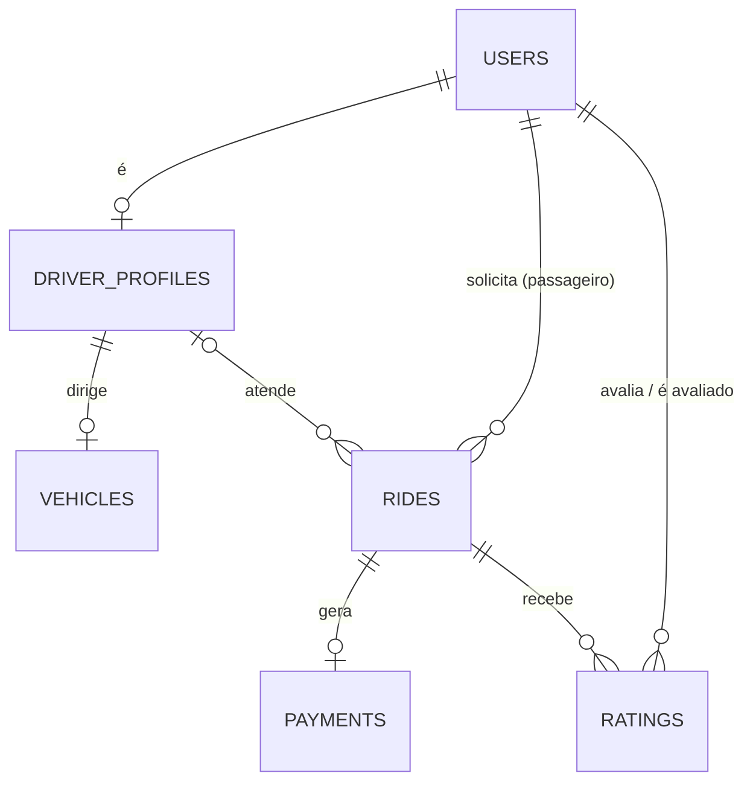
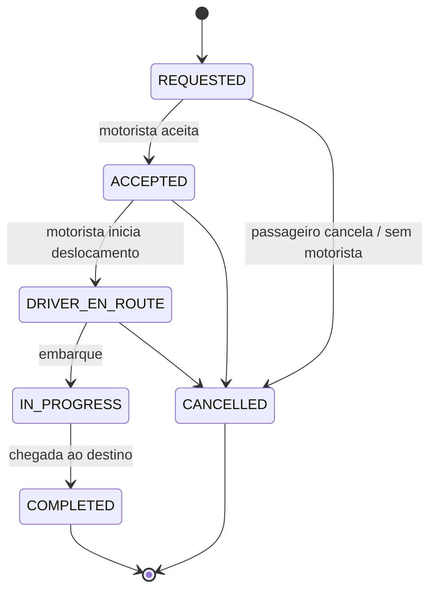

# Modelo de domínio

## Diagrama ER

## Máquina de estados da corrida

## Decisões de modelagem

| Tema | Decisão | Motivo |
|---|---|---|
| Passageiro e motorista | Tabela `users` com `role` + `driver_profiles` 1:1 | Um único fluxo de autenticação; dados de motorista separados |
| Papéis | Um papel por usuário | Evita tabela de papéis; quem quiser os dois cria duas contas |
| Identificadores | UUID v7 | Não enumerável na API, gerado na aplicação, índice ordenado por tempo |
| Dinheiro | `BIGINT` em centavos, moeda fixa BRL | Sem erro de ponto flutuante; simples de serializar |
| Coordenadas | `DOUBLE PRECISION` (latitude, longitude) | Suficiente para Haversine; PostGIS só se a Fase 7 exigir |
| Veículo | 1:1 com o motorista | Simplicidade; limitação conhecida |
| Recusa de corrida | Fora da máquina de estados | A corrida segue `REQUESTED`; ofertas viram tabela na Fase 7 |
| Cancelamento | Só antes do embarque; guarda `cancelled_by` e motivo | `IN_PROGRESS` só termina em `COMPLETED` |
